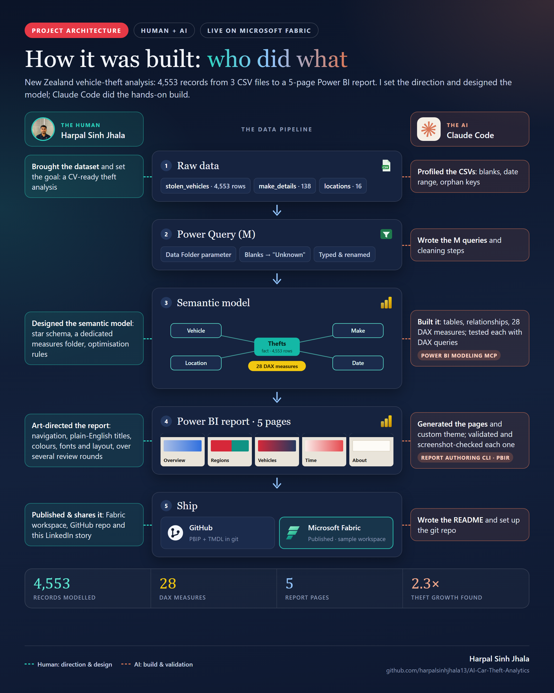

# New Zealand Vehicle Theft Analysis — Power BI

Project documentation for the **AI Car Theft Analytics** Power BI report.



| | |
|---|---|
| **Purpose** | Show how many vehicles were stolen in New Zealand, where, which vehicles, and when |
| **Audience** | Portfolio / CV viewers, general business users |
| **Data period** | 7 Oct 2021 – 6 Apr 2022 (Oct 2021 and Apr 2022 are partial months) |
| **Format** | Power BI Project (PBIP) — report in PBIR, model in TMDL |
| **Built with** | Power BI Desktop, Power Query (M), DAX, Claude Code |
| **Published** | Microsoft Fabric — `sample` workspace |

---

## 1. Data sources

Three CSV files in the `Data` folder (source: NZ Police stolen vehicle records).

| File | Rows | Content |
|---|---|---|
| `stolen_vehicles.csv` | 4,553 | One row per stolen vehicle: type, make, model year, description, colour, date stolen, region |
| `make_details.csv` | 138 | Vehicle make name and type (Standard / Luxury) |
| `locations.csv` | 16 | Region, country, population, population density |

The folder path is set by the Power Query parameter **`Data Folder`**. To move the project, change this one parameter (Transform data → Manage parameters).

**Data cleaning applied in Power Query**
- 15 thefts with no make → mapped to an `Unknown` make (Make ID −1).
- Blank vehicle type, description or colour → `Unknown`.
- Population text such as `"1,695,200"` → whole number.
- Dates parsed as US format (M/D/YY).

---

## 2. Data model

Star schema: one fact table, four dimensions, one measures table.

| Table | Type | Grain / purpose | Key |
|---|---|---|---|
| **Thefts** | Fact | One row per stolen vehicle | Vehicle ID |
| **Vehicle** | Dimension | Type, description, colour, model year, model decade | Vehicle ID |
| **Make** | Dimension | Make name, make type | Make ID |
| **Location** | Dimension | Region, country, population, density | Location ID |
| **Date** | Dimension | Daily calendar 2021–2022 (marked as date table) | Date |
| **Key Measures** | Measures | Holds all 28 measures, no data | — |

**Relationships** (all many-to-one, single direction):

```
Thefts[Vehicle ID]  → Vehicle[Vehicle ID]
Thefts[Make ID]     → Make[Make ID]
Thefts[Location ID] → Location[Location ID]
Thefts[Date Stolen] → Date[Date]
```

**Hierarchies:** Date → Year › Quarter › Month › Date; Make → Make Type › Make.

**Optimisation settings:** key and helper columns hidden, implicit measures disabled, auto date/time off, integer keys, sort-by columns on month and weekday names, descriptions on all tables, columns and measures.

---

## 3. Measures

All measures are in **Key Measures**, grouped into display folders.

| Folder | Measures |
|---|---|
| 1. Theft Volume | Total Thefts, Luxury Thefts, Standard Thefts, Weekend Thefts |
| 2. Share and Mix | % of Total Thefts, Luxury Theft %, Weekend Theft % |
| 3. Daily Activity | Average Daily Thefts, Peak Daily Thefts, First Theft Date, Latest Theft Date |
| 4. Time Intelligence | Thefts MTD, Thefts YTD, Thefts Running Total, Thefts Previous Month, Thefts MoM Change, Thefts MoM %, Thefts 7-Day Rolling Average |
| 5. Location | Population, Thefts per 100K Population, Region Theft Rank, Top Region |
| 6. Vehicle and Make | Average Vehicle Age, Makes Stolen, Make Theft Rank, Top Stolen Make, Top Stolen Vehicle Type, Top Stolen Color |

**Key definitions**

| Measure | Logic |
|---|---|
| Total Thefts | `COUNTROWS('Thefts')` — base measure for everything else |
| Average Daily Thefts | Thefts ÷ calendar days in context that fall inside the data window |
| Thefts per 100K Population | Thefts ÷ population × 100,000 |
| Thefts 7-Day Rolling Average | Thefts in the last 7 days ÷ 7 |
| Thefts MoM % | (This month − previous month) ÷ previous month |
| Average Vehicle Age | Average of (theft year − model year); unknown model years excluded |

Time-intelligence measures return blank for dates after the last recorded theft, so charts don't show empty future months.

---

## 4. Report pages

| # | Page | Question answered | Main visuals |
|---|---|---|---|
| 1 | Overview | How many vehicles were stolen, and is it getting worse? | 6 KPI cards, daily trend area chart, region treemap, standard vs luxury donut, vehicle types bar, monthly column |
| 2 | Regions | Where in New Zealand are vehicles being stolen? | Total thefts by region, theft rate per 100K, population vs thefts scatter, regional scorecard |
| 3 | Vehicles | Which vehicles do thieves target? | 6 KPI cards, top 15 makes, top 8 types, top 8 colours, model decade |
| 4 | Time Patterns | When do thefts happen? | Monthly thefts + MoM % combo, average per weekday, weekday × month heatmap |
| 5 | About | How was this built? | Overview, method, key findings, tools |

**Slicers:** Region and Make Type (Vehicle Type on page 2). Slicers filter their own page only.
**Navigation:** an Apple-style segmented page switcher in the top bar of every page.

---

## 5. Key findings

- Monthly thefts more than doubled: **464** (Oct 2021) → **1,053** (Mar 2022).
- **Auckland** has 36% of thefts, but **Gisborne** has the highest rate (338 per 100K).
- Only **4.2%** of stolen vehicles are luxury makes; **Toyota**, **stationwagons** and **silver** cars lead.
- **Monday** is the busiest day (~30 thefts/day); weekends are quieter (~22).

---

## 6. Design standards

| Element | Standard |
|---|---|
| Canvas | 1920 × 1080 |
| Style | "Warm minimal": Claude-inspired palette and serif headlines, Apple-style cards and navigation |
| Theme | `TheftAnalyticsWarm` (custom JSON in `StaticResources/RegisteredResources`) |
| Background / cards | Ivory canvas `#F4F1EA`; white cards, 16 px radius, hairline border `#E9E5DC`, soft long shadow |
| Top bar | White with hairline divider; segmented page switcher (track `#ECE8E0`, selected tab white) |
| Fonts | Georgia (titles and headlines), Segoe UI Light (KPI numbers), Segoe UI / Semibold (body, labels) |
| Colours | Terracotta `#D4693F`, Teal `#1F7A6E`, Ocean `#2F6BB3`, Amber `#D98E1F`, Plum `#7B5EA7`, Ink `#2B2B2A` |
| Chart colour | Value gradients on bars and columns: the biggest value gets the deepest colour |
| Accessibility | Alt text on every visual; exact numbers (no K/M rounding) on labels |

---

## 7. Maintenance

**Refresh data:** replace the CSVs in `Data` (same file names and columns), open `AI Car Theft Analytics.pbip`, click **Refresh**. If the date range grows beyond 2022, the Date table extends automatically.

**Rebuild report pages:** the pages and theme are generated by `_brief/build-report.js`. Close Power BI Desktop (or use *Apply external changes* afterwards), then run:

```bash
node _brief/build-report.js
```

> Don't press **Save** in Desktop while it shows *"This project's files were changed externally"* — that would overwrite the regenerated files with the older in-memory version.

**Folder structure**

```
AI Car Theft Analytics/
├── AI Car Theft Analytics.pbip          ← open this in Power BI Desktop
├── AI Car Theft Analytics.Report/       ← report pages (PBIR) + theme
├── AI Car Theft Analytics.SemanticModel/← data model (TMDL)
├── Data/                                ← source CSV files
├── _brief/                              ← report spec + page generator script
├── LinkedIn/                            ← architecture and showcase graphics
└── README.md                            ← this document
```

---

## 8. Known limitations

- Oct 2021 and Apr 2022 are partial months, so their monthly totals look low.
- "Trailer" appears as both a make and a vehicle type in the source data.
- Three regions (Tasman, Marlborough, West Coast) have no recorded thefts.
- Population figures are static and don't change over the period.
- The published Fabric report holds a data snapshot: the CSV source is on a local PC, so scheduled refresh in the service would need a gateway or moving the files to OneLake.
